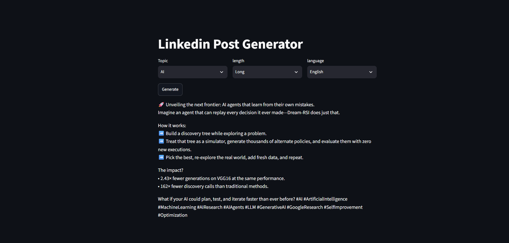
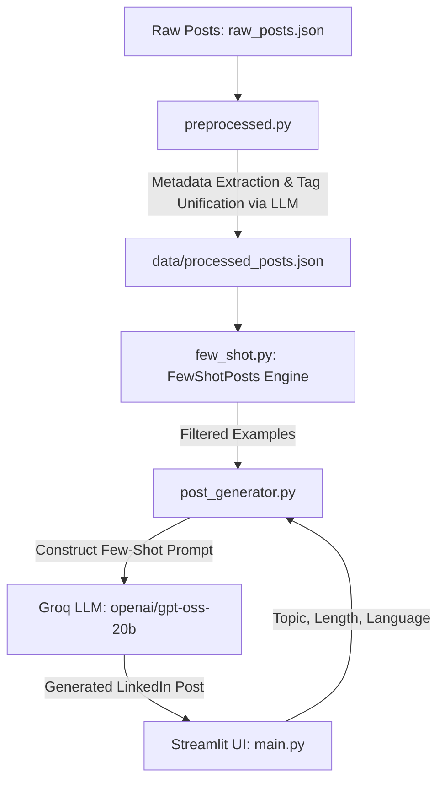

# 🚀 Linkedin Post Generator Using Langchain and Groq API

An AI-powered LinkedIn post generator that leverages **Few-Shot Prompting**, **LangChain**, and **Groq Cloud LLMs** to generate realistic, high-engagement LinkedIn posts in a creator's distinct writing style. The application features an interactive **Streamlit** user interface allowing users to customize post topics, lengths, and languages (including English and Banglish).

---

## 📌 Project Overview

Generating authentic-sounding LinkedIn posts with standard zero-shot LLM prompts often yields generic, robotic results. This project solves that problem by building an end-to-end Few-Shot Learning pipeline:

1. **Curates 20+ real LinkedIn posts** from a creator's profile with authentic engagement metrics.
2. **Enriches and preprocesses** data using an LLM to extract metadata (line counts, language, and unified semantic tags).
3. **Dynamically retrieves few-shot exemplars** matching the desired length, language, and topic.
4. **Synthesizes fresh posts** matching the author's writing style, formatting, and emoji usage via Groq's high-speed inference.
5. **Provides a clean Streamlit interface** for instantaneous generation.

---

## 📺 Demo & Walkthrough

### 🖥️ Streamlit Web Interface


### 🎥 Video Walkthrough
[](https://youtu.be/1mZTfNVaXe4)

> 🔗 **Watch the full demo on YouTube:** [https://youtu.be/1mZTfNVaXe4](https://youtu.be/1mZTfNVaXe4)

---

## 🏗️ System Architecture



---

## 🛠️ What I Have Done in This Project

### 1. Data Collection & Preprocessing Pipeline (`preprocessed.py`)
- **Profile Data Harvesting**: Selected a target LinkedIn creator profile and curated a dataset of 20+ real, high-engagement posts (`data/raw_posts.json`).
- Built an automated metadata extraction chain using **LangChain `PromptTemplate`** and **`JsonOutputParser`** to extract:
  - `line_count`: Total lines in the post.
  - `language`: Detected language (`English` or `Banglish`).
  - `tags`: Core subject matter keywords.
- **LLM-Powered Tag Unification**: Implemented semantic tag clustering to map disparate, inconsistent hashtags (e.g., `"AI"`, `"ArtificialIntelligence"`, `"DeepMind"`) into clean, unified Title Case categories (e.g., `"Artificial Intelligence"`).
- Persisted normalized structured records into `data/processed_posts.json`.

### 2. Few-Shot Dynamic Exemplar Engine (`few_shot.py`)
- Built the `FewShotPosts` class using **Pandas** to manage and query past posts.
- Categorized post lengths based on actual line distribution:
  - **Short**: `< 5 lines` (1 to 5 lines)
  - **Medium**: `5 to 10 lines` (6 to 10 lines)
  - **Long**: `> 10 lines` (11 to 15 lines)
- Created a filtering method `get_filtered_posts()` that queries historical examples matching the user's target parameters (Topic, Language, Length).

### 3. Prompt Engineering & Generation Engine (`post_generator.py`)
- Designed dynamic few-shot prompt construction:
  - Injects target criteria (topic, length constraint, language rules).
  - Handles specialized requirements (e.g., **Banglish** instruction: phonetic mix of Bengali and English written strictly in English script).
  - Automatically appends up to 2 past successful posts as writing style benchmarks.
- Integrated **Groq API** via `langchain-groq` using the `openai/gpt-oss-20b` model for ultra-low latency inference.

### 4. Interactive Web Application (`main.py`)
- Developed a web UI with **Streamlit** organized in a 3-column layout:
  - **Topic**: Dynamically populated from available tags in the dataset.
  - **Length**: Short, Medium, Long.
  - **Language**: English, Banglish.
- Wired a responsive "Generate" button to trigger the pipeline and render the generated post in real-time.

---

## 💡 What I Have Learned From This Project

1. **Power of Few-Shot Prompting**:
   - Learned how few-shot examples guide LLMs to capture tone, whitespace formatting, hook sentences, and emoji usage significantly better than complex zero-shot instructions alone.
2. **LLM-Based Data Cleaning & Enrichment**:
   - Gained practical experience using LLMs to structure unstructured text and perform semantic normalization/clustering on noisy categorical tags.
3. **Structured Outputs with LangChain**:
   - Mastered `JsonOutputParser` and `PromptTemplate` chaining (`chain = pt | llm`) to enforce strict JSON schemas and handle parsing exceptions gracefully.
4. **Groq Cloud & Model Deployment**:
   - Experienced Groq's LPU inference speed, enabling near-instantaneous post generation compared to traditional API endpoints.
5. **Full-Stack AI Application Development**:
   - Connected data processing, prompt engineering, backend business logic, and frontend Streamlit presentation into a cohesive software architecture.
6. **Debugging & Software Engineering Best Practices**:
   - Handled UTF-8 console encoding challenges on Windows.
   - Practiced modular code separation (`llm_helper`, `preprocessed`, `few_shot`, `post_generator`, `main`).
   - Managed environment variables securely via `.env` and `.gitignore`.

---

## 📂 Repository Structure

```
Linkedin Post Generator Using Langchain and Groq API/
│
├── data/
│   ├── raw_posts.json           # Raw LinkedIn post data & engagement metrics
│   └── processed_posts.json     # Enriched posts with line counts, tags, & languages
│
├── .env.example                 # Environment variables template
├── .gitignore                   # Ignored files (virtual envs, secrets, pycache)
├── few_shot.py                  # Few-shot retrieval engine & length categorizer
├── llm_helper.py                # Groq LLM client configuration
├── main.py                      # Streamlit frontend application
├── post_generator.py            # Prompt assembly & post generation logic
├── preprocessed.py              # Data preprocessing, metadata extraction & tag unification
├── requirements.txt             # Project dependencies
├── image.png                    # Demo screenshot of the Streamlit application
└── README.md                    # Project documentation
```

---

## 🚀 Getting Started

### 1. Prerequisites
- Python 3.10+ installed
- A Groq API Key ([Get one free on Groq Console](https://console.groq.com/))

### 2. Clone the Repository
```bash
git clone https://github.com/raihan12121/Linkedin-Post-Generator-Using-Langchain-and-Groq-API.git
cd Linkedin-Post-Generator-Using-Langchain-and-Groq-API
```

### 3. Setup Virtual Environment
```bash
# Windows
python -m venv myvenv
myvenv\Scripts\activate

# macOS / Linux
python3 -m venv myvenv
source myvenv/bin/activate
```

### 4. Install Dependencies
```bash
pip install -r requirements.txt
```

### 5. Configure Environment Variables
Create a `.env` file in the project root:
```env
GROQ_API_KEY=your_groq_api_key_here
```

### 6. (Optional) Re-run Data Preprocessing
To re-process raw posts and regenerate `data/processed_posts.json`:
```bash
python preprocessed.py
```

### 7. Run the Application
Launch the Streamlit web dashboard:
```bash
streamlit run main.py
```
Open your browser at `http://localhost:8501`.

---

## 🌟 Example Generation

- **Topic**: `Artificial Intelligence`
- **Length**: `Short`
- **Language**: `English`

**Output:**
> 🔍 **Exploring the Future of Agentic AI**  
> We're moving from AI that merely generates text to autonomous agents that plan, reason, and take action in complex software environments. 🚀  
> The shift isn't just about bigger models—it's about better tool integration and execution loops.  
> What workflow would you automate with AI agents today?  
> #ArtificialIntelligence #AIAgents #MachineLearning #TechTrends
